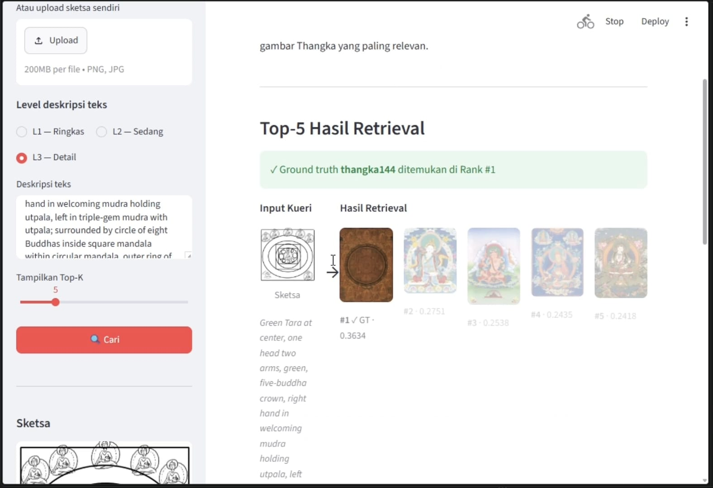

# ENCODER Research

**Enhanced ENCODER for Composed Thangka Image Retrieval via Domain Adaptation and Hierarchical Text Alignment**

Molion Syahputra Mulya dan Cendra Putra, Universitas Negeri Surabaya (UNESA).

Artikel penelitian: [DOI: 10.67561/jaids.v2i1.4](https://doi.org/10.67561/jaids.v2i1.4)



## Tentang penelitian

Penelitian ini membahas Composed Image Retrieval (CIR) untuk gambar Thangka: pengguna memberikan sketsa dan deskripsi teks, kemudian sistem mencari gambar yang paling relevan. Evaluasi menggunakan benchmark CIRThan dengan tiga tingkat deskripsi: L1 (ringkas), L2 (sedang), dan L3 (detail).

Penelitian mengembangkan ENCODER dengan empat komponen:

- **Cross-Domain Projection (CDP):** adapter residual untuk menjembatani perbedaan representasi sketsa dan gambar Thangka.
- **Level-Aware Tags (LAT):** penanda tingkat deskripsi untuk membantu model membedakan informasi teks L1, L2, dan L3.
- **Hard Negative Mining (HNM):** pembelajaran dari pasangan negatif yang sulit dibedakan.
- **UCDR Domain Prompts:** prompt visual yang dapat dilatih untuk adaptasi domain pada backbone CLIP.

## Model yang digunakan demo

Demo menggunakan checkpoint **ENCODER + CDP + LAT + HNM, seed 123**, dengan hasil terbaik satu seed **Avg R@1 = 58,95%**. Checkpoint ini berbeda dari varian penuh yang juga menggunakan UCDR. Hasil varian penuh yang dilaporkan dalam penelitian adalah Avg R@1 55,61%; baseline re-run adalah 52,91%.

| Tingkat deskripsi | R@1 (%) | R@3 (%) | R@5 (%) |
| --- | ---: | ---: | ---: |
| L1 | 56,80 | 78,76 | 84,01 |
| L2 | 58,95 | 79,24 | 85,68 |
| L3 | 61,10 | 80,91 | 86,16 |
| Rata-rata | **58,95** | **79,64** | **85,28** |

R@K adalah persentase kueri yang gambar targetnya ditemukan dalam K hasil teratas. Angka di atas berasal dari catatan hasil penelitian lokal, bukan evaluasi ulang pada saat pengemasan repositori.

## Isi repositori

- `demo/`: aplikasi Streamlit dengan halaman retrieval, informasi penelitian, dan Tanya AI.
- `demo/gallery_cache/`: embedding dan ID untuk 419 gambar galeri demo.
- [Checkpoint demo (GitHub Release)](https://github.com/Lymous/ENCODER-Research/releases/tag/demo-seed123): unduh `enhanced_best.123.pt`, kemudian simpan sebagai `results/enhanced_best 123.pt`.
- `picture/1.jpeg`: gambar yang ditampilkan pada README.

Notebook training dan folder implementasi model tidak disertakan. File aplikasi demo tetap berisi kode integrasi dan wrapper `CIRThanEncoder` yang diperlukan oleh aplikasi asli. Checkpoint merupakan bobot model, bukan program yang dapat dijalankan sendiri.

Checkpoint berukuran sekitar 606 MiB dan didistribusikan melalui GitHub Release, terpisah dari riwayat Git. Buat folder `results/` bila belum ada setelah clone.

SHA-256 checkpoint:

```text
a57b84ad54abcfc5923f1e42cfa36303843a30a72572e49f5f033ffe5c923878
```

## Menjalankan pada lingkungan penelitian lokal

Repositori ini belum merupakan paket mandiri. Selain isi repositori, aplikasi membutuhkan:

1. Folder `ENCODER_repo_new/` berisi implementasi model dan modul pendukungnya.
2. Weight CLIP `ENCODER_repo/open_clip_pytorch_model.bin`.
3. Dataset `CIRThan/`, termasuk gambar, sketsa, `image_splits/`, dan `captions/test.json`.
4. Environment Python penelitian dengan Streamlit, PyTorch, OpenCLIP, Transformers, NumPy, pandas, Pillow, einops, dan Google GenAI. Implementasi model saat ini menggunakan CUDA.

Tempatkan komponen tersebut pada root proyek dengan susunan yang sama seperti lingkungan penelitian asli. Backbone juga mencari `./open_clip_pytorch_model.bin`; pada Linux, buat symlink dari root proyek:

```bash
ln -s ENCODER_repo/open_clip_pytorch_model.bin open_clip_pytorch_model.bin
conda run -n LLMproject streamlit run 'demo/🔍_Demo_Retrieval.py'
```

Jalankan perintah dari root proyek. Untuk halaman Tanya AI, sediakan `GEMINI_API_KEY` melalui konfigurasi secrets Streamlit lokal. API key tidak disertakan dalam repositori; fitur ini memerlukan akses internet dan layanan Gemini.

## Atribusi

Penelitian dikembangkan di atas ENCODER dan menggunakan CLIP serta benchmark CIRThan. Kepemilikan kode, model dasar, dan dataset pihak ketiga tetap mengikuti sumber serta lisensinya masing-masing. Lihat artikel pada tautan DOI untuk konteks metode, evaluasi, dan referensi penelitian.
